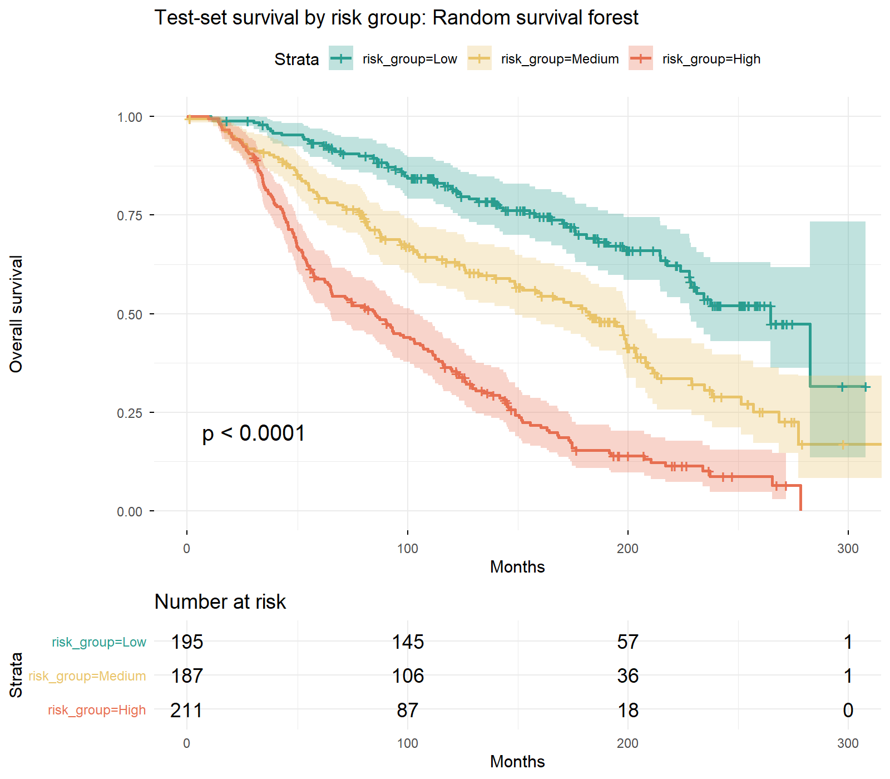

# Breast Cancer Survival Analysis & Risk Stratification in R

> **End-to-end analytics portfolio project | R · survival · mice · ranger · gtsummary · survminer · Quarto**

**One-screen summary:** Exploratory survival analysis of about 2,000 METABRIC breast cancer patients in R. A Cox model and a random survival forest reach a similar held-out C-index (about 0.69), and a three-tier risk grouping separates survival clearly (high vs low risk HR 4.3 to 4.7). Results are observational associations for all-cause survival, not a validated clinical tool.



**Full report:** _add your GitHub Pages or RPubs link here_

## 1. Project Overview

This project builds a survival-analysis workflow on clinical data from the METABRIC breast cancer cohort (about 2,000 patients with usable survival data). It combines data cleaning and validation, missing-data analysis, Kaplan–Meier estimation, multivariable Cox regression, a random survival forest, held-out model evaluation, and low/medium/high risk grouping.

The goal is to show how an analyst can move from raw clinical records to explainable findings and a simple risk-grouping tool that non-technical stakeholders can use. All results describe **associations** in observational data; they do not establish that any characteristic or treatment causes better or worse survival.

## 2. Business Problem

A cancer care provider has long-term follow-up data on its patients but no clear, data-backed view of who is most at risk. As a result, follow-up and support resources tend to be spread evenly rather than focused on the patients who need them most, and clinical teams cannot easily see which characteristics matter most for survival.

**Business questions**
- Which patient and tumor characteristics are associated with shorter survival after adjusting for the others?
- How does survival differ by stage, grade, age group, and hormone receptor / HER2 status?
- Is the proportional hazards assumption reasonable, and what should be done where it is not?
- Does a machine-learning survival model predict better than a standard Cox model on unseen patients?
- Can patients be grouped into low, medium, and high risk with clearly different survival?
- What must be validated before using such a tool for follow-up planning?

## 3. Key Results at a Glance

These are the latest results from the R pipeline. Re-run the scripts and confirm the split, outcome definition, and model code are unchanged before presenting them as final.

| Item | Result |
|---|---:|
| Patients in raw files | 2,509 |
| Patients with valid survival data (analysis cohort) | 1,980 |
| Deaths (all-cause) | 1,144 (57.8%) |
| Complete cases for the primary Cox model | 1,354 |
| Held-out test set | 593 patients |
| Test C-index, Cox proportional hazards | 0.686 (95% CI 0.656–0.716) |
| Test C-index, random survival forest | 0.690 (95% CI 0.661–0.720) |
| Hazard ratio, medium vs low risk group | Cox 1.98 (1.45–2.69); forest 2.08 (1.52–2.84) |
| Hazard ratio, high vs low risk group | Cox 4.32 (3.27–5.71); forest 4.69 (3.51–6.27) |

**Interpretation caution:** the outcome is all-cause death, so the age effect includes deaths unrelated to breast cancer. A C-index near 0.69 is moderate. Risk groups were built for both models and neither was chosen using test results. The hazard ratios come from held-out patients but a single train/test split. Hazard ratios are average effects over follow-up because proportional hazards is violated for several variables.

## 4. Dataset

The project uses the METABRIC breast cancer study, downloaded from cBioPortal (study ID `brca_metabric`). Only the **clinical** patient and sample files are used; gene-expression and genomic columns are excluded to keep the analysis focused.

- **Source files:** `data_clinical_patient.txt` and `data_clinical_sample.txt`
- **Unit of analysis:** one row per patient (the two files are joined on `PATIENT_ID`)
- **Outcome:** overall survival, defined as time from diagnosis to death from any cause (`OS_MONTHS`, `OS_STATUS`); living patients are treated as censored
- **Variables used:** age at diagnosis, tumor size, stage, grade, positive lymph nodes, ER / PR / HER2 status, chemotherapy, hormone therapy, radiotherapy
- **Raw data:** not committed to this repository; download it from cBioPortal and place it in `data/raw/` unchanged

Confirm the exact files and column names in your download before reproducing results, because cBioPortal exports vary slightly.

## 5. Methodology

### Data preparation and validation
1. Load the patient and sample files, skipping the four `#` metadata lines, and standardize column names.
2. Check keys and row counts before and after the join (2,509 patients in both files).
3. Convert survival status to a numeric event indicator and confirm survival times are valid.
4. Drop patients with missing or non-positive survival time (529 patients), leaving 1,980.
5. Standardize category labels and collapse sparse stage levels (stage 0–1 and stage 3–4) to avoid unstable estimates.
6. Record every step in a cleaning log.

### Missing-data analysis
Chart missingness by variable (stage about 26%, grade and positive nodes about 4% each, tumor size about 1%) and compare patients with and without missing key variables. Patients with any missing value had a somewhat higher death rate (61.7% vs 56.0%), so the groups are not identical. The main Cox model is fitted two ways: complete-case (n = 1,354) and multiple imputation (m = 5, pooled with Rubin's rules), with imputation treated as the primary analysis. The imputation model includes the event indicator and the Nelson–Aalen cumulative hazard, as is standard for survival outcomes.

### Exploratory analysis
Summarize patient characteristics in a Table 1 split by outcome, and plot age, grade, and tumor-size distributions. Observe that stage, grade, age, and node involvement differ between patients who died and those who were censored.

### Survival analysis and Cox regression
Estimate Kaplan–Meier curves by stage, grade, age group, hormone receptor status, and HER2 status, with log-rank tests. Fit a multivariable Cox model and report hazard ratios with 95% confidence intervals. Test the proportional hazards assumption using Schoenfeld residuals and address violations through targeted stratification and a 10-year truncated sensitivity model rather than stratifying every variable.

### Machine learning and model comparison
Split patients 70/30, stratified by event. For this part, impute the predictors only (no outcome information), learning the imputation model from training rows only, scale numeric variables with training means and standard deviations, and fit a random survival forest on the training set. Compare Cox and the forest on the held-out test set using the concordance index (C-index).

### Risk grouping
Build risk groups for both models, so no model is chosen using test results. Set low / medium / high cut points at training-set tertiles (out-of-bag cumulative hazards for the forest), apply them to the test set, and compare survival across the groups with Kaplan–Meier curves, a log-rank test, and hazard ratios versus the low-risk group. Training and test forest scores have closely matching distributions (medians 327 vs 335), so the cut points transfer.

## 6. Project Architecture

```text
METABRIC clinical files (cBioPortal)
     |
     v
Import, join, validate, clean  ──>  Cleaning log + missingness checks
     |
     v
Analysis dataset (one row per patient)
     |
     +------------------------------+
     |                              |
     v                              v
Exploratory analysis           Kaplan–Meier + log-rank tests
     |                              |
     +---------------+--------------+
                     |
                     v
         Cox model (complete-case + imputation)
         PH check, ER stratification, 10-year sensitivity
                     |
                     v
       70/30 split: Cox vs random survival forest (C-index)
                     |
                     v
         Low / medium / high risk groups on held-out data
                     |
                     v
          Quarto report + figures + README
```

## 7. Project Pipeline

1. **Import and stage:** read the two clinical files and join on patient ID.
2. **Validate:** check keys, row counts, survival times, and event coding.
3. **Clean:** standardize labels, recode stage, and write a cleaning log.
4. **Assess missingness:** chart it and compare outcomes for complete vs incomplete records.
5. **Explore:** build Table 1 and descriptive charts.
6. **Estimate survival:** Kaplan–Meier curves and log-rank tests by key groups.
7. **Fit Cox models:** complete-case and multiply-imputed, with a forest plot of hazard ratios.
8. **Check proportional hazards:** Schoenfeld residuals, ER stratification, and a 10-year truncated model.
9. **Train and compare:** Cox and random survival forest on a leakage-free train/test split.
10. **Group by risk:** tertile cut points from training data, applied to test data, for both models.
11. **Report:** render a Quarto report with plain-language findings and limitations.

## 8. Tech Stack

| Technology | Use |
|---|---|
| R | Analysis and workflow |
| tidyverse | Data manipulation and plotting |
| janitor | Column-name standardization |
| naniar | Missing-data summaries and charts |
| mice | Multiple imputation and train-only imputation |
| gtsummary | Table 1 summary table |
| survival | Kaplan–Meier, Cox regression, Schoenfeld tests, concordance |
| survminer | Survival curves with risk tables |
| broom | Tidy model output |
| ranger | Random survival forest |
| Quarto | Reproducible report |
| Git / GitHub | Version control and hosting |

## 9. Models

| Model | Role |
|---|---|
| Kaplan–Meier estimator | Describe survival by patient group |
| Log-rank test | Compare survival curves across groups |
| Cox proportional hazards (complete-case) | Adjusted hazard ratios, primary check |
| Cox proportional hazards (multiple imputation) | Adjusted hazard ratios, primary analysis |
| ER-stratified Cox model | Handle the clearest proportional hazards violation (also resolves HER2) |
| 10-year truncated Cox model | Sensitivity check on time-varying effects |
| Random survival forest | Flexible model with no proportional hazards assumption |

## 10. Evaluation Metrics

- **Log-rank p-value:** tests whether survival curves differ between groups.
- **Hazard ratio (HR) and 95% CI:** effect size per characteristic, adjusted for the others.
- **Schoenfeld residual test:** tests the proportional hazards assumption for each variable and globally.
- **C-index (concordance):** how often a model ranks the patient who died earlier as higher risk; 0.5 is chance and 1.0 is perfect.
- **Risk-group hazard ratios:** separation between low, medium, and high groups on held-out patients.

## 11. Model Comparison

| Model | Test C-index | 95% CI |
|---|---:|---|
| Cox proportional hazards | 0.686 | 0.656–0.716 |
| Random survival forest | 0.690 | 0.661–0.720 |

**Finding:** the two models perform essentially the same; the 0.004 difference is well within the confidence intervals. The forest does not assume proportional hazards, so matching Cox despite the violations shows the flexible model gains little here. Risk groups were built for both models, so neither was selected on the test set. A C-index near 0.69 is moderate, which is realistic for clinical variables alone.

## 12. Results and Key Findings

**Survival by group (Kaplan–Meier, log-rank):** stage (p < 0.0001), grade (p < 0.0001), age group (p < 0.0001), and HER2 status (p < 0.0001) all show clear differences. Hormone receptor status is borderline (p = 0.051) because its curves cross at about 170–190 months: hormone receptor-negative patients do worse early and better later.

**Adjusted hazard ratios (multiple-imputation Cox model):**

| Characteristic | Hazard ratio | 95% CI |
|---|---:|---|
| Age (per year) | 1.043 | 1.036–1.049 |
| Tumor size (per mm) | 1.0075 | 1.0035–1.0114 |
| Positive lymph nodes (per node) | 1.050 | 1.036–1.064 |
| Stage 2 vs 0–1 | 1.30 | 1.10–1.55 |
| Stage 3–4 vs 0–1 | 1.51 | 1.04–2.17 |
| Grade 3 vs 1 | 1.36 | 1.06–1.75 |
| HER2-positive | 1.38 | 1.15–1.65 |
| Radiotherapy | 0.77 | 0.68–0.88 |

- Age, tumor size, nodal involvement, stage, HER2 status, and radiotherapy are significant in both the complete-case and imputed models.
- Grade 3 is significant after imputation but not in the complete-case model (HR 1.27, p = 0.13), which has less power.
- Chemotherapy has a hazard ratio above 1 (1.45 imputed). This reflects confounding by indication: sicker patients receive chemotherapy. It should not be read as chemotherapy causing harm.
- Proportional hazards is violated for age, stage, grade, ER status, HER2 status, chemotherapy, and hormone therapy (global p < 0.001). Stratifying on ER status resolves the HER2 violation and leaves the other estimates essentially unchanged, but age, stage, grade, chemotherapy, and hormone therapy still fail the test.
- A time-varying age model shows the age hazard ratio growing with follow-up (roughly 1.01 per year at 1 year, 1.04 at 5 years, 1.05 at 10 years), which is plausible for an all-cause outcome.
- In the first 10 years, effects are stronger for several variables (stage 3–4 HR 2.02, ER-positive HR 0.75, hormone therapy HR 0.71), which indicates that effects weaken over longer follow-up.
- On 593 held-out patients, the risk groups separate clearly (log-rank p < 0.0001). Estimated 100-month survival is roughly 84% (low), 67% (medium), and 44% (high), read approximately from the forest's Kaplan–Meier curves.
- Risk groups were built for both Cox and the forest, and neither was chosen using test results. Medium vs low HR is 1.98 (Cox) and 2.08 (forest); high vs low is 4.32 and 4.69.

## 13. Business Impact and Follow-Up Prioritization

This project estimates risk, not costs, so there is no financial scenario analysis. The practical value is in prioritizing limited follow-up capacity:

- The high-risk tier has about 4.3 to 4.7 times the hazard of death of the low-risk tier (Cox 4.32, forest 4.69), and the medium tier about 2.0 to 2.1 times.
- Roughly one third of patients fall in each tier by construction, so the tool tells a clinic where to focus, not how many patients need follow-up in total.
- Because predictive accuracy is moderate (C-index about 0.69), the tiers are suitable for prioritizing attention, not for making individual treatment decisions.

Any estimate of how much follow-up changes outcomes would require a controlled comparison, which this retrospective data cannot provide.

## 14. Business Recommendations

1. **Treat the tiers as exploratory risk stratification, not a validated decision tool.** Any use should combine them with clinical judgment.
2. **If follow-up is prioritized, older, node-positive, higher-stage, grade 3, and HER2-positive patients are natural groups to review first,** since they have the highest adjusted hazards. This analysis cannot show that extra follow-up would improve outcomes.
3. **Do not treat treatment associations as proof of effect.** Radiotherapy and chemotherapy hazard ratios reflect how patients were selected for treatment.
4. **Pilot before deploying.** Test the tiers in a small follow-up program and track outcomes in each tier over time.
5. **Revalidate on newer data.** METABRIC patients were diagnosed decades ago; treatment and survival have changed.
6. **Consider a cause-specific outcome.** Separating breast-cancer deaths from other deaths would give a cleaner picture of age effects.
7. **Report time-varying effects honestly.** Describe hazard ratios as averages over follow-up and note that several effects are stronger early.

## 15. Report and Figures

The Quarto report (`reports/report.qmd`) renders to a self-contained HTML file. Key figures saved in `figures/`:

1. **Missingness chart:** missing values by variable.
2. **Descriptive charts:** age, grade-by-outcome, and tumor-size distributions.
3. **Kaplan–Meier curves:** by stage, grade, age group, hormone receptor status, and HER2 status, each with a risk table.
4. **Forest plot:** adjusted hazard ratios for the complete-case and imputed models.
5. **Schoenfeld residual plots:** proportional hazards diagnostics.
6. **Model comparison and forest importance:** held-out C-index and permutation importance.
7. **Risk-group curves:** test-set survival by low, medium, and high risk, for Cox and for the forest.

Published report: 

[View the Interactive Breast Cancer Survival Analysis Report](https://maanyasaxena.github.io/breast-cancer-survival-analysis/)

## 16. Limitations

- **Observational data:** results are associations, not causal effects.
- **All-cause outcome:** age hazard ratios include deaths unrelated to breast cancer.
- **Missing data:** stage is missing for about 26% of patients; complete-case and imputed results differ for some variables, and patients with missing data had a somewhat higher death rate.
- **Proportional hazards violations:** several variables violate the assumption, so hazard ratios are average effects over follow-up.
- **Treatment confounding:** treatments were not randomized, so chemotherapy and other treatment associations are confounded by indication.
- **Single cohort and era:** findings may not generalize to other populations or current treatment.
- **Single train/test split:** the C-index estimate has some sampling variance. Risk groups were built for both models rather than choosing one on the test set, and the two give similar separation.
- **Moderate predictive accuracy:** C-index of about 0.69 limits use for individual-level decisions.
- **Clinical variables only:** genomic information is not used.
- **Sparse categories:** stage 0 and stage 4 are rare and were merged with neighboring levels.

## 17. Repository Structure

Adapt this tree to the files that actually exist in the repository.

```text
breast-cancer-survival/
├── README.md
├── data/
│   ├── raw/                       
│   └── clean/                     
├── scripts/
│   ├── 00_setup.R
│   ├── 01_clean.R
│   ├── 02_explore.R
│   ├── 03_survival.R
│   ├── 04_models.R
│   └── run_all.R
├── reports/
│   └── report.qmd                 # plus rendered HTML
├── docs/
│   └── index.html                 # copy of the rendered report for GitHub Pages
└── figures/                       # saved charts
```

## 18. Outputs

| Output | Purpose |
|---|---|
| `data/clean/metabric_clean.csv` | Cleaned, analysis-ready patient dataset |
| `data/clean/cleaning_log.txt` | Record of cleaning decisions and row counts |
| `data/clean/missingness_summary.csv` | Missing values by variable |
| `data/clean/missingness_vs_outcome.csv` | Outcomes for complete vs incomplete records |
| `data/clean/logrank_results.csv` | Log-rank p-values by group |
| `data/clean/cox_hazard_ratios.csv` | Complete-case and imputed hazard ratios |
| `data/clean/ph_test.csv` | Proportional hazards test results |
| `data/clean/ph_test_er_strat.csv` | Proportional hazards test after ER stratification |
| `data/clean/cox_stratified.csv` | ER-stratified Cox model |
| `data/clean/cox_10yr.csv` | 10-year truncated Cox model |
| `data/clean/model_comparison.csv` | Test-set C-index for each model |
| `data/clean/risk_group_hr.csv` | Hazard ratios by risk group, for Cox and the forest |
| `figures/*.png` | Report figures, including `risk_groups_cox.png` and `risk_groups_rsf.png` |
| `reports/report.html` | Rendered Quarto report |

## 19. Skills Demonstrated

- R data wrangling and reproducible pipelines
- Data validation, joining, and cleaning logs
- Missing-data analysis and multiple imputation
- Kaplan–Meier estimation and log-rank testing
- Cox regression and hazard-ratio interpretation
- Proportional hazards diagnostics and remedies
- Random survival forests
- Leakage-free train/test evaluation and C-index comparison
- Risk stratification and communicating results to non-technical audiences
- Reproducible reporting with Quarto and Git/GitHub
- Communicating assumptions, limitations, and uncertainty

## 20. Reproducibility

1. Download the METABRIC study (`brca_metabric`) from cBioPortal and place `data_clinical_patient.txt` and `data_clinical_sample.txt` in `data/raw/` without editing them.
2. Open the project in R or RStudio and confirm R packages are installed (`00_setup.R` installs missing ones).
3. Run `source("scripts/run_all.R")`, or run scripts `01` to `04` in order, then render the report. If the report cannot find its input files, run `here::set_here()` once from the project folder so that `here()` finds the project root.
4. Recheck the cleaning log, missingness tables, proportional hazards output, C-index table, and risk-group results.
5. Confirm that the stage collapse is applied and that figures are saved with white backgrounds.
6. Update this README and the report text if a re-run changes any numbers.

The random seed (2026) is set in `00_setup.R` so splits and imputations repeat.

## Portfolio Takeaway

This project connects careful data preparation and missing-data handling with survival analysis, honest assumption checking, and held-out model comparison. Its contribution is not a high model score: it shows how to turn clinical follow-up data into explainable hazard ratios and a simple three-tier risk grouping, while stating plainly where the assumptions fail and what the results cannot prove.
